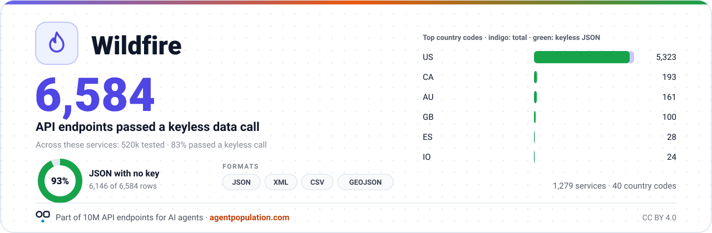
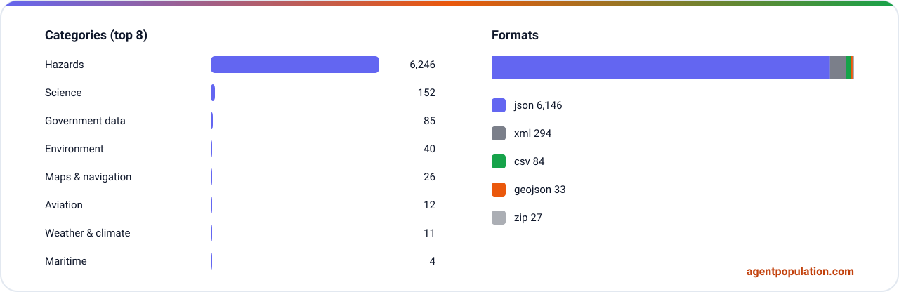

<p align="center"></p>

# 🔥 Wildfire API endpoints

**6,584 wildfire API endpoints that answered a keyless GET with a data body. For agent and app builders.**

<p align="center"><a href="#files"></a> <a href="#columns-and-tags"></a> <a href="#whats-inside"></a> <a href="#whats-inside"></a> <a href="LICENSE"></a></p>

<p align="center"><a href="#whats-in-it-for-you">What's in it</a> · <a href="#for-ai-agents">For AI agents</a> · <a href="#quick-start">Quick start</a> · <a href="#test-it-yourself">Test it yourself</a> · <a href="#files">Files</a> · <a href="#licence-and-credit">Licence</a> · <a href="#part-of-10m-api-endpoints-for-ai-agents">More packs</a></p>

This repository holds a 1,000-row sample and the services list; the full list of 6,584 endpoints is one download from the [latest release](https://github.com/agentpopulation/6.5k-wildfire-apis-for-agents/releases/latest).

**Endpoints for building a wildfire and fire-danger map.** US interagency fire perimeters and incident locations (WFIGS), fire weather outlooks (NOAA), fire-danger ratings for Canada and Australia, bushfire overlays, burn-severity and fire-history layers, and wildfire-risk layers from forest services and local governments, as URLs that answered with no key on their test date.

Selection rule: rows where `tags has wildfire`, less the rows that a leave-out rule drops (each counted under Known limits).

3,250 of these 6,584 rows match the focus rule (below); the others are in the pack by the selection rule only, and Known limits says what they are. 4,517 rows (68.6%) are map layers on ArcGIS Online, where anyone can publish.

## In plain words

**What is an API endpoint?** An API endpoint is one web address that a program can ask for data, for example the latest reading at one weather station. A single service, such as a national weather agency, can have thousands of endpoints: one per station, city or dataset. This pack counts endpoints, not separate services.

**What does "passed a data call" mean?** On the date shown in each row, AgentPopulation sent one plain request to that address, with no password or key, and got a non-empty data body back (JSON, CSV, XML or a file): not an error page and not an empty result. Some bodies describe a dataset rather than hold its values; see Known limits. It shows the address answered with data on that day. It is not a promise that it answers today, and licences and usage limits were not reviewed.

## What's in it for you

Four ways to use this pack. Each bucket gives a count, a filter you can apply to the CSV, one example that passed, and a list of recommended starting points with the rule that picked them. Buckets overlap; a row can fit more than one.

Examples, recommended lists and the preview are drawn from rows that match this pack's focus rule, so a row that the selection rule put in this pack but that is about something else is not shown as a starting point. Counts cover the whole bucket.

<details>
<summary>The focus rule</summary>

Focus rule: `title matches /wild ?fires?|wildland|bush ?fires?|forest ?fires?|brush ?fires?|grass ?fires?|veld ?fires?|fire ?(perimet|danger|weather|histor|risk|hazard|season|occurrence|severity|behavio|regime|threat|incident|ignition|scar|footprint|progression|prone|management|mitigation|protection plan|resilien)|burn(ed|t)? ?(area|scar|severity|probability|perimet)|prescribed (burn|fire)|\bfuels?\b|smoke|hot ?spots?|\bwui\b|wildland.urban|fireshed|cwpp|\bmtbs|wfigs|\bfirms\b|viirs|incendi|waldbrand|bosbrand|feux? de for|požiar|poziar/i AND NOT title matches /fire ?stations?|hydrant|fire ?districts?|fire ?departments?|fire ?hall|police/i AND NOT title matches /missing person/i AND NOT url matches /request=getcapabilities|/csw/i AND NOT title matches /superseded/i AND NOT host in (sampleserver6.arcgisonline.com, test.maps.gov.bc.ca)`

</details>

### 🤖 Agent tools: Fire perimeters, fire-danger and wildfire-risk layers an agent can query

**2,986** endpoints from 938 services · Wrap one layer query as a get_fire_layer tool: pass a place or bounding box, return the fire name, size, containment or danger class with a timeout.

2,828 of these are map-layer queries that asked for a few records (`resultRecordCount`); raise it or page through for the whole layer.

Start with: `tags has agent-ready AND title matches /wild ?fires?|wildland|bush ?fires?|forest ?fires?|brush ?fires?|grass ?fires?|veld ?fires?|fire ?(perimet|danger|weather|histor|risk|hazard|season|occurrence|severity|behavio|regime|threat|incident|ignition|scar|footprint|progression|prone|management|mitigation|protection plan|resilien)|burn(ed|t)? ?(area|scar|severity|probability|perimet)|prescribed (burn|fire)|\bfuels?\b|smoke|hot ?spots?|\bwui\b|wildland.urban|fireshed|cwpp|\bmtbs|wfigs|\bfirms\b|viirs|incendi|waldbrand|bosbrand|feux? de for|požiar|poziar/i`

Example: [Mapped fire perimeters from the Sky Island Mounta…](https://doi.org/10.5066/F76Q1WJ1) · Doi · passed 2026-11-15

<details>
<summary>Recommended starting points: 8 services, picked by the stated criteria inside</summary>

**Recommended starting points.** Selected by stated criteria, not a ranking of quality: Services in this pack with the most endpoints that match this bucket and are tagged `agent-ready` (no key sent in the test call, JSON body, passed a data call). Ties go to the service with more country codes, then by name. Only services with at least one bucket row that matches the focus rule are listed, and the sample comes from those rows; the counts cover the whole bucket. The sample URL is the first row by URL sort after preferring, in this order: rows that match the bucket's sample preference when it has one, rows that return values rather than describe a dataset or a service (not ERDDAP /info/ pages, OGC GetCapabilities requests, bare OWS addresses, PxWeb tables, UN SDG series lists, Statistics Canada download pointers, WorldPop listings, GTFS validation reports, untitled rows or service root addresses), and agent-ready rows. Sample preference in this bucket: `NOT url matches ///(services[0-9]*(-[a-z0-9]+)?|utility)\.arcgis\.com//i AND title matches /current|\bactive|incident|perimet|hot ?spots?|fire danger|fire weather|\bfirms\b|viirs/i`. Services named "ArcGIS organization" hold map layers from many owners and are added only when fewer than 5 other services match.

| Service (host) | Endpoints in bucket | In pack | Country codes in bucket | Formats in bucket | Sample URL that passed |
|---|---:|---:|---|---|---|
| Doi (doi.org) | 53 | 73 | global or unknown | json | [Mapped fire perimeters from the Sky Isl…](https://doi.org/10.5066/F76Q1WJ1) (2026-11-15) |
| Usda (apps.fs.usda.gov) | 51 | 68 | US | json | [National USFS Final Fire Perimeter (Fea…](https://apps.fs.usda.gov/arcx/rest/services/EDW/EDW_FireOccurrenceAndPerimeter_01/MapServer/10/query?where=1%3D1&outFields=*&returnGeometry=false&resultRecordCount=5&f=json) (2026-11-14) |
| ArcGIS Online for Ontario Schools (ArcGIS Online) (services.arcgis.com) | 47 | 49 | CA | json | [- Forest Fires 5okm](https://services.arcgis.com/QI0dObYawrKkuwDp/arcgis/rest/services/-%20Forest%20Fires%205okm/FeatureServer/0/query?where=1%3D1&outFields=*&returnGeometry=false&resultRecordCount=5&f=json) (2026-11-15) |
| Oregon ArcGIS Online (ArcGIS Online) (services.arcgis.com) | 47 | 67 | US | json | [2020 Wildfire VOC Sampling - View](https://services.arcgis.com/uUvqNMGPm7axC2dD/arcgis/rest/services/2020_Wildfire_VOC_Sampling_-_View/FeatureServer/0/query?where=1%3D1&outFields=*&returnGeometry=false&resultRecordCount=5&f=json) (2026-11-14) |
| National Interagency Fire Center (ArcGIS Online) (services3.arcgis.com) | 44 | 132 | US | json | [NIFC Wildfires Point Locations Last 24 …](https://services3.arcgis.com/T4QMspbfLg3qTGWY/ArcGIS/rest/services/WFIGS_Incident_Locations_Last24h/FeatureServer/0/query?where=1%3D1&outFields=*&returnGeometry=false&resultRecordCount=5&f=json) (2026-11-14) |
| UC Davis Continuing and Professional Education (ArcGIS Online) (services7.arcgis.com) | 39 | 48 | 6 codes | json | [Air Monitoring Stations and wildfires\_W…](https://services7.arcgis.com/yiuFazTjHE8F5gzQ/arcgis/rest/services/Air_Monitoring_Stations_and_wildfires_WFL1/FeatureServer/0/query?where=1%3D1&outFields=*&returnGeometry=false&resultRecordCount=5&f=json) (2026-11-14) |
| U.S. Forest Service (ArcGIS Online) (services1.arcgis.com) | 38 | 119 | US | json | [2020\_Oregon\_Wildfires](https://services1.arcgis.com/gGHDlz6USftL5Pau/arcgis/rest/services/2020_Oregon_Wildfires/FeatureServer/0/query?where=1%3D1&outFields=*&returnGeometry=false&resultRecordCount=5&f=json) (2026-11-14) |
| gisuat.mcgi.state.mi.us | 31 | 31 | US | json | [gisuat.mcgi.state.mi.us: DNR/Wildfire /…](https://gisuat.mcgi.state.mi.us/arcgis/rest/services/DNR/Wildfire/MapServer/0/query?where=1%3D1&outFields=*&resultRecordCount=10&f=json) (2026-11-15) |

</details>

### 📱 App features: Fire perimeters, incidents, hotspots and fire-danger maps

**565** endpoints from 247 services · Draw the fires near a user on a map: query a perimeter or incident layer with a bounding box (`geometry=` and `returnGeometry=true`), then shade the area by fire-danger rating.

Start with: `title matches /current|\bactive|incident|perimet|hot ?spots?|fire danger|fire weather|\bfirms\b|viirs/i`

Example: [Active Wildfire](https://services3.arcgis.com/T4QMspbfLg3qTGWY/arcgis/rest/services/EGP_Active_Incidents_Prod_Public_View/FeatureServer/0/query?where=1%3D1&outFields=*&returnGeometry=false&resultRecordCount=5&f=json) · National Interagency Fire Center (ArcGIS Online) · passed 2026-11-14

<details>
<summary>Recommended starting points: 8 services, picked by the stated criteria inside</summary>

**Recommended starting points.** Selected by stated criteria, not a ranking of quality: Services in this pack with the most endpoints that match this bucket and passed a data call. Ties go to the service with more country codes, then by name. Only services with at least one bucket row that matches the focus rule are listed, and the sample comes from those rows; the counts cover the whole bucket. The sample URL is the first row by URL sort after preferring, in this order: rows that match the bucket's sample preference when it has one, rows that return values rather than describe a dataset or a service (not ERDDAP /info/ pages, OGC GetCapabilities requests, bare OWS addresses, PxWeb tables, UN SDG series lists, Statistics Canada download pointers, WorldPop listings, GTFS validation reports, untitled rows or service root addresses), and agent-ready rows. Sample preference in this bucket: `title matches /current|active/i`. Services named "ArcGIS organization" hold map layers from many owners and are added only when fewer than 5 other services match.

| Service (host) | Endpoints in bucket | In pack | Country codes in bucket | Formats in bucket | Sample URL that passed |
|---|---:|---:|---|---|---|
| Napsgfoundation (prep-response-portal.napsgfoundation.org) | 50 | 90 | global or unknown | json, zip, csv | [US Fire Perimeters 2011 - CSV](https://prep-response-portal.napsgfoundation.org/api/download/v1/items/9c407d9f46624e98aa4fca1520a3a8f7/csv?layers=11) (2026-11-15) |
| National Interagency Fire Center (ArcGIS Online) (services3.arcgis.com) | 40 | 132 | US | json | [Active Wildfire](https://services3.arcgis.com/T4QMspbfLg3qTGWY/arcgis/rest/services/EGP_Active_Incidents_Prod_Public_View/FeatureServer/0/query?where=1%3D1&outFields=*&returnGeometry=false&resultRecordCount=5&f=json) (2026-11-14) |
| California Department of Forestry and Fire Protection (ArcGIS Online) (services1.arcgis.com) | 15 | 54 | US | json | [2023 California Fire Perimeters View](https://services1.arcgis.com/jUJYIo9tSA7EHvfZ/arcgis/rest/services/2023_California_Fire_Perimeters_View/FeatureServer/0/query?where=1%3D1&outFields=*&returnGeometry=false&resultRecordCount=5&f=json) (2026-11-14) |
| CA Governor's Office of Emergency Services (ArcGIS Online) (services.arcgis.com) | 14 | 32 | US | json | [Current Wildfires from IRWIN Public View](https://services.arcgis.com/BLN4oKB0N1YSgvY8/arcgis/rest/services/Current_Wildfires_from_IRWIN_Public_View/FeatureServer/0/query?where=1%3D1&outFields=*&returnGeometry=false&resultRecordCount=5&f=json) (2026-11-14) |
| California Natural Resources Agency Open (gis.data.cnra.ca.gov) | 8 | 10 | US | csv, zip, json | [California Fire Perimeters (all) - GeoJ…](https://gis.data.cnra.ca.gov/api/download/v1/items/c3c10388e3b24cec8a954ba10458039d/geojson?layers=0) (2026-11-15) |
| U.S. Forest Service (ArcGIS Online) (services1.arcgis.com) | 8 | 119 | US | json | [ActiveWildfires12\_2021\_9\_2023](https://services1.arcgis.com/gGHDlz6USftL5Pau/arcgis/rest/services/ActiveWildfires12_2021_9_2023/FeatureServer/0/query?where=1%3D1&outFields=*&returnGeometry=false&resultRecordCount=5&f=json) (2026-11-14) |
| Louisiana Homeland Security and Emergency Preparedness (ArcGIS Online) (services1.arcgis.com) | 7 | 8 | US | json | [Highway 113 Wildfire Perimeter for Augu…](https://services1.arcgis.com/fXHQyq63u0UsTeSM/arcgis/rest/services/Highway_113_Wildfire_Perimeter_for_August_31/FeatureServer/0/query?where=1%3D1&outFields=*&returnGeometry=false&resultRecordCount=5&f=json) (2026-11-14) |
| The Claremont Colleges Library (ArcGIS Online) (services.arcgis.com) | 7 | 31 | US | json | [CA Fire Hotspots](https://services.arcgis.com/hVnyNvwbpFFPDV5j/arcgis/rest/services/CA_Fire_Hotspots/FeatureServer/0/query?where=1%3D1&outFields=*&returnGeometry=false&resultRecordCount=5&f=json) (2026-11-14) |

</details>

### 🧠 Grounding and data pipelines: Fire history, burn severity, fuels and wildfire-risk layers for scheduled loads

**1,288** endpoints from 446 services · Load fire history and wildfire-risk layers on a schedule into your own store, so answers about the fire risk at a place cite a dated source and a layer name.

Start with: `title matches /histor|risk|hazard|fuels?\b|severity|\bmtbs|occurrence|prone|overlay|regime|burn(ed|t)? ?area|incendi|waldbrand/i OR format in (csv, xml, zip)`

Example: [Fire severity, sagebrush types, and soil regimes …](https://data.usgs.gov/datacatalog/metadata/USGS.5628198be4b0d158f5926acc.xml) · Usgs · passed 2026-11-15

<details>
<summary>Recommended starting points: 8 services, picked by the stated criteria inside</summary>

**Recommended starting points.** Selected by stated criteria, not a ranking of quality: Services in this pack with the most endpoints that match this bucket and passed a data call. Ties go to the service with more country codes, then by name. Only services with at least one bucket row that matches the focus rule are listed, and the sample comes from those rows; the counts cover the whole bucket. The sample URL is the first row by URL sort after preferring, in this order: rows that match the bucket's sample preference when it has one, rows that return values rather than describe a dataset or a service (not ERDDAP /info/ pages, OGC GetCapabilities requests, bare OWS addresses, PxWeb tables, UN SDG series lists, Statistics Canada download pointers, WorldPop listings, GTFS validation reports, untitled rows or service root addresses), and agent-ready rows. Sample preference in this bucket: `NOT url matches ///(services[0-9]*(-[a-z0-9]+)?|utility)\.arcgis\.com//i`. Services named "ArcGIS organization" hold map layers from many owners and are added only when fewer than 5 other services match.

| Service (host) | Endpoints in bucket | In pack | Country codes in bucket | Formats in bucket | Sample URL that passed |
|---|---:|---:|---|---|---|
| Usgs (data.usgs.gov) | 204 | 204 | US | xml | [Fire severity, sagebrush types, and soi…](https://data.usgs.gov/datacatalog/metadata/USGS.5628198be4b0d158f5926acc.xml) (2026-11-15) |
| Napsgfoundation (prep-response-portal.napsgfoundation.org) | 55 | 90 | global or unknown | csv, zip, xml, json | [Wildfire History by Age - GeoJSON](https://prep-response-portal.napsgfoundation.org/api/download/v1/items/99599b05214b452fa152fa28b0098a13/geojson?layers=0) (2026-11-15) |
| National Interagency Fire Center (ArcGIS Online) (services3.arcgis.com) | 46 | 132 | US | json | [AK Fire History Summary](https://services3.arcgis.com/T4QMspbfLg3qTGWY/arcgis/rest/services/AK_Fire_History_Summary/FeatureServer/0/query?where=1%3D1&outFields=*&returnGeometry=false&resultRecordCount=5&f=json) (2026-11-14) |
| Usda (apps.fs.usda.gov) | 40 | 68 | US | json | [National USFS Fire Occurrence Point (Fe…](https://apps.fs.usda.gov/arcx/rest/services/EDW/EDW_FireOccurrenceAndPerimeter_01/MapServer/9/query?where=1%3D1&outFields=*&returnGeometry=false&resultRecordCount=5&f=json) (2026-11-14) |
| Canadian Urban Data Catalogue (CUDC) (openmaps.gov.bc.ca) | 23 | 23 | CA | xml | [Fire Burn Severity - Same Year - Downlo…](https://openmaps.gov.bc.ca/kml/geo/layers/WHSE_FOREST_VEGETATION.VEG_BURN_SEVERITY_SAME_YR_SP_loader.kml) (2026-11-15) |
| U.S. Forest Service (ArcGIS Online) (services1.arcgis.com) | 22 | 119 | US | json | [Douglas Ranger District Fuels Treatments](https://services1.arcgis.com/gGHDlz6USftL5Pau/arcgis/rest/services/DRDFinal_%282%29/FeatureServer/0/query?where=1%3D1&outFields=*&returnGeometry=false&resultRecordCount=5&f=json) (2026-11-14) |
| BrisMAP Public (ArcGIS Online) (services2.arcgis.com) | 21 | 21 | AU, US | json | [City Plan 2014 - Bushfire overlay](https://services2.arcgis.com/dEKgZETqwmDAh1rP/arcgis/rest/services/Bushfire_overlay/FeatureServer/0/query?where=1%3D1&outFields=*&returnGeometry=false&resultRecordCount=5&f=json) (2026-11-14) |
| Doi (doi.org) | 17 | 73 | global or unknown | json | [Data Release for the Validation of the …](https://doi.org/10.5066/F7T151VX) (2026-11-15) |

</details>

### 🧪 Evals and testing: Perimeters, danger ratings and history layers to test a fire tool

**6,584** endpoints · 1,279 services · 40 country codes · 5 formats · Run your fire tool against a fixed set of URLs across formats; check that fire name, area, date or danger class parse, and keep last_tested as the baseline for your own re-tests.

Start with: the whole pack

Example: [Annual Wildfires](https://services1.arcgis.com/0MSEUqKaxRlEPj5g/arcgis/rest/services/Annual_Wildfires/FeatureServer/0/query?where=1%3D1&outFields=*&returnGeometry=false&resultRecordCount=5&f=json) · ArcGIS Online layers (services1.arcgis.com, org 0MSEUqKaxRlEPj5g) · passed 2026-11-14

<details>
<summary>Recommended starting points: 8 services, picked by the stated criteria inside</summary>

**Recommended starting points.** Selected by stated criteria, not a ranking of quality: Services in this pack that returned the most different formats, then the most endpoints that passed a data call, then by name: a mix of response shapes to test parsers and tool calls. Only services with at least one bucket row that matches the focus rule are listed, and the sample comes from those rows; the counts cover the whole bucket. The sample URL is the first row by URL sort after preferring, in this order: rows that match the bucket's sample preference when it has one, rows that return values rather than describe a dataset or a service (not ERDDAP /info/ pages, OGC GetCapabilities requests, bare OWS addresses, PxWeb tables, UN SDG series lists, Statistics Canada download pointers, WorldPop listings, GTFS validation reports, untitled rows or service root addresses), and agent-ready rows. Services named "ArcGIS organization" hold map layers from many owners and are added only when fewer than 5 other services match.

| Service (host) | Endpoints in bucket | In pack | Country codes in bucket | Formats in bucket | Sample URL that passed |
|---|---:|---:|---|---|---|
| Napsgfoundation (prep-response-portal.napsgfoundation.org) | 90 | 90 | global or unknown | json, csv, zip, xml, geojson | [Wildfire History by Age - GeoJSON](https://prep-response-portal.napsgfoundation.org/api/download/v1/items/99599b05214b452fa152fa28b0098a13/geojson?layers=0) (2026-11-15) |
| ArcGIS Online: ACT Canopy Cover 2020 1m WESTON (actmapi-actgov.opendata.arcgis.com) | 8 | 8 | AU | csv, json, zip, xml | [Bushfire Prone Area Overview 2026 - Geo…](https://actmapi-actgov.opendata.arcgis.com/api/download/v1/items/d555612fcbdd414d9c584f3b301dd746/geojson?layers=0) (2026-11-15) |
| Sdsc (scil-data.sdsc.edu) | 14 | 14 | US | json, csv, geojson | [Wildfire Risk Modeling Exercise: ckan\_r…](https://scil-data.sdsc.edu/data/ul-risk-modeling-2026/Forest/Forest_Treelist.geojson) (2026-11-15) |
| California Natural Resources Agency Open (gis.data.cnra.ca.gov) | 10 | 10 | US | zip, csv, json | [California Fire Perimeters (all) - GeoJ…](https://gis.data.cnra.ca.gov/api/download/v1/items/c3c10388e3b24cec8a954ba10458039d/geojson?layers=0) (2026-11-15) |
| data.gov.au (datahub.moretonbay.qld.gov.au) | 9 | 9 | AU | json, csv, xml | [Overlay Maps:OC02 Bushfire Hazard - CSV](https://datahub.moretonbay.qld.gov.au/api/download/v1/items/2fa171d648414bc3834c74f0def35069/csv?layers=1) (2026-11-15) |
| Austintexas (data.austintexas.gov) | 7 | 7 | US | json, xml, zip | [Wildfire Hazard Potential Treatment Are…](https://data.austintexas.gov/api/views/2x9t-5ctm/rows.json?accessType=DOWNLOAD) (2026-11-15) |
| data.gov.au (www.data.act.gov.au) | 4 | 4 | AU | json, csv, xml | [2003\_Bushfire\_Data](https://www.data.act.gov.au/api/v3/views/sksx-b49e/query.json?accessType=DOWNLOAD) (2026-11-15) |
| Caribbeangeoportal (www.caribbeangeoportal.com) | 3 | 3 | global or unknown | csv, json, xml | [Satellite (VIIRS) Thermal Hotspots and …](https://www.caribbeangeoportal.com/api/download/v1/items/dece90af1a0242dcbf0ca36d30276aa3/geojson?layers=0) (2026-11-15) |

</details>

The same lists are in [recommended.json](recommended.json), ready for an agent to load.

## Questions an agent can answer with this pack

- Which US wildfires have a mapped perimeter at the moment, and how large are they? The tested URL asks for five records and no geometry; raise `resultRecordCount` for more and set `returnGeometry=true` for the shapes. Try [Current Wildfire Perimeters - WFIGS](https://services3.arcgis.com/T4QMspbfLg3qTGWY/arcgis/rest/services/WFIGS_Interagency_Perimeters_Current/FeatureServer/0/query?where=1%3D1&outFields=*&returnGeometry=false&resultRecordCount=5&f=json) (National Interagency Fire Center (ArcGIS Online), passed 2026-11-14).
- Which current US wildfire incidents does WFIGS list, and when were they discovered? Set `returnGeometry=true` for their locations. Try [Current Wildfire Incidents - WFIGS](https://services3.arcgis.com/T4QMspbfLg3qTGWY/arcgis/rest/services/WFIGS_Incident_Locations_Current/FeatureServer/0/query?where=1%3D1&outFields=*&returnGeometry=false&resultRecordCount=5&f=json) (National Interagency Fire Center (ArcGIS Online), passed 2026-11-14).
- Where does the Storm Prediction Center outline elevated fire weather for day 1? Try [Weather - Wildfire - Live - Polygon - Fire Weathe…](https://mapservices.weather.noaa.gov/vector/rest/services/fire_weather/SPC_firewx/MapServer/1/query?where=1%3D1&outFields=*&returnGeometry=false&resultRecordCount=5&f=json) (Noaa, passed 2026-11-14).
- What fire-danger class does the Canadian fire-danger map give a region? Try [Fire Danger Map of Canada](https://services.arcgis.com/wjcPoefzjpzCgffS/arcgis/rest/services/Active_Fire_Danger_Map_of_Canada/FeatureServer/0/query?where=1%3D1&outFields=*&returnGeometry=false&resultRecordCount=5&f=json) (Esri Canada (ArcGIS Online), passed 2026-11-14).

## What "passed a data call" means

> [!NOTE]
> On the date in `last_tested` (IST), one GET to the URL, sent with no key, returned HTTP 2xx and a non-empty data body. HTML pages and empty results did not pass. The `format` column records what came back. This is a test result for that date, not a promise that the URL answers today. Licences, terms, rate limits, accuracy and freshness were not reviewed. Endpoints are URLs, not separate APIs; many share one service. This pack was tested 10–15 Nov 2026; snapshot 15 Nov 2026.

## For AI agents

Start from keyless JSON endpoints (`agent-ready`). The code below loads `recommended.json` and calls the first recommended service in the Agent tools bucket, with a timeout (`node examples/agent-start.mjs --recommended`). With no argument, `node examples/agent-start.mjs` calls the most recently tested agent-ready row of the sample; pass a `.csv` or `.csv.gz` path to use that file instead. See [examples/agent-start.mjs](examples/agent-start.mjs).

```js
// Node 18+. Loads recommended.json (the local copy, or the raw file on GitHub) and calls one keyless JSON endpoint.
import fs from 'node:fs';

const RAW = 'https://raw.githubusercontent.com/agentpopulation/6.5k-wildfire-apis-for-agents/main/recommended.json';
const rec = fs.existsSync('recommended.json')
  ? JSON.parse(fs.readFileSync('recommended.json', 'utf8'))
  : await (await fetch(RAW)).json();

const pick = rec.buckets.find((b) => b.id === 'agent').services[0];
try {
  const res = await fetch(pick.sample_url, {
    headers: { 'User-Agent': 'agent-example/1.0' },
    signal: AbortSignal.timeout(15000),
  });
  console.log(pick.service, res.status, res.headers.get('content-type'));
  console.log((await res.text()).slice(0, 300));
} catch (err) {
  console.log(`did not answer now; last passed ${pick.sample_last_tested} (${err.message})`);
}
```

How an agent picks an endpoint:

1. Filter to `agent-ready` and your country or topic.
2. Prefer the newest `last_tested` and the larger services.
3. Call with a timeout and check the body before you use it.

## Quick start

The examples run against the sample in `data/` out of the box (1,000 rows). Each takes an optional path to a `.csv` or `.csv.gz` file instead.

```bash
git clone https://github.com/agentpopulation/6.5k-wildfire-apis-for-agents.git
cd 6.5k-wildfire-apis-for-agents
python examples/quickstart.py
node examples/quickstart.mjs
node examples/agent-start.mjs
```

Full list: download `Wildfire_API_Endpoints_AgentPopulation_Snapshot_2026-11-15.csv.gz` (6,584 rows, 319.9 kB) from [releases/latest](https://github.com/agentpopulation/6.5k-wildfire-apis-for-agents/releases/latest), then gunzip it and pass its path. The scripts also read the `.csv.gz` as it is.

```bash
gunzip Wildfire_API_Endpoints_AgentPopulation_Snapshot_2026-11-15.csv.gz
python examples/quickstart.py Wildfire_API_Endpoints_AgentPopulation_Snapshot_2026-11-15.csv
node examples/quickstart.mjs Wildfire_API_Endpoints_AgentPopulation_Snapshot_2026-11-15.csv
```

### curl

Quote the URL: some contain commas.

```bash
curl -sL "https://raw.githubusercontent.com/agentpopulation/6.5k-wildfire-apis-for-agents/main/data/Wildfire_API_Endpoints_AgentPopulation_Sample.csv" | head -n 4
curl -s --max-time 15 "https://doi.org/10.5066/F76Q1WJ1" | head -c 600
```

### Python

Standard library only: [examples/quickstart.py](examples/quickstart.py) reads the sample, or the path you pass, keeps agent-ready rows and calls the most recently tested one.

<details>
<summary>The code</summary>

```python
# Python 3, standard library only. Run from a clone of this repository:
#   python examples/quickstart.py [path]
# With no path it reads the sample in data/. Pass the full list from the latest release (.csv or .csv.gz) instead.
# Keeps agent-ready rows and calls the most recently tested one.
import csv
import gzip
import os
import re
import sys
import urllib.request

HERE = os.path.dirname(os.path.abspath(__file__))
path = sys.argv[1] if len(sys.argv) > 1 else os.path.join(HERE, "..", "data", "Wildfire_API_Endpoints_AgentPopulation_Sample.csv")
opener = gzip.open if path.endswith(".gz") else open
with opener(path, "rt", newline="", encoding="utf-8") as f:
    rows = list(csv.DictReader(f))

agent = [r for r in rows if "agent-ready" in r["tags"].split("|")]
# Newest test date first; URLs that describe a dataset or a service rather than return values go last.
DESCRIBES = re.compile(r"/erddap/info/|action-report\.json$|[?&]request=getcapabilities|/GeoArea/[^/?]+/List|getFullTableDownloadCSV|hub\.worldpop\.org", re.I)
agent.sort(key=lambda r: r["last_tested"], reverse=True)
agent.sort(key=lambda r: 1 if DESCRIBES.search(r["url"]) else 0)
print(len(rows), "rows,", len(agent), "agent-ready")
if not agent:
    sys.exit(0)

row = agent[0]
req = urllib.request.Request(row["url"], headers={"User-Agent": "agent-example/1.0"})
try:
    with urllib.request.urlopen(req, timeout=15) as res:
        body = res.read(1_000_000).decode("utf-8", "replace")
        print(res.status, res.headers.get("Content-Type"))
        print(body[:300])
except Exception as err:
    print(f"did not answer now; last passed {row['last_tested']} ({err})")
```

</details>

### JavaScript

Reads the sample as JSON because the CSV has quoted commas.

<details>
<summary>The code</summary>

```js
// Node 18+. Reads the sample as JSON (the CSV has quoted commas), local file first.
import fs from 'node:fs';

const FILE = 'data/Wildfire_API_Endpoints_AgentPopulation_Sample.json';
const rows = fs.existsSync(FILE)
  ? JSON.parse(fs.readFileSync(FILE, 'utf8'))
  : await (await fetch('https://raw.githubusercontent.com/agentpopulation/6.5k-wildfire-apis-for-agents/main/data/Wildfire_API_Endpoints_AgentPopulation_Sample.json')).json();

const row = rows.find((r) => r.tags.includes('agent-ready'));
const res = await fetch(row.url, { headers: { 'User-Agent': 'agent-example/1.0' }, signal: AbortSignal.timeout(15000) });
console.log(res.status, (await res.text()).slice(0, 300));
```

</details>

### Agent tools

[examples/agent-tools.json](examples/agent-tools.json) holds two tool definitions in the shape most tool-calling APIs accept (name, description, JSON Schema); rename `parameters` if yours uses another key. [examples/quickstart.mjs](examples/quickstart.mjs) implements them:

- `find_endpoints` searches the agent-ready rows of the list by words, country code (their format is json). When you load the tools of more than one pack, prefix the names (for example `wildfire_find_endpoints`) so they do not clash.
- `fetch_endpoint` calls one URL, **refuses any URL that is not in the list** and does not follow redirects. The allowlist is built from the CSV, so a URL injected into a prompt is refused.

The same two tools can sit behind an MCP server.

## Test it yourself

Re-test endpoints from the sample with the same rule: HTTP 2xx and a non-empty body that is not an HTML page. Node 18+, no packages.

```bash
node tools/test-endpoints.mjs
```

It tests the first 50 URLs and prints one line: tested, passed, did not pass. Options: a `.csv` or `.csv.gz` path (the full list from the release), `--limit 50`, `--timeout-ms 10000`, `--out results.csv`. The results file holds `url`, `status`, `passed`, `content_type`, `ms` and `checked_at`; a status of `timeout` or `error:<code>` means no HTTP answer came back. It is polite: GET only, no key sent, at most 4 requests in flight, one at a time per listed host, at least 1 second between requests to one listed host, and reading stops once 256 kB of a body is kept. Redirects are followed and may lead to another host. `results.csv` is in `.gitignore`.

## Preview

One row from each of the five largest services among rows that match the focus rule, services with rows that return values first.

| Title | Service | Country | Format | Tested | Link |
|---|---|---|---|---|---|
| Fire severity, sagebrush types, and soil regimes within lar… | Usgs | US | xml | 2026-11-15 | [data.usgs.gov](https://data.usgs.gov/datacatalog/metadata/USGS.5628198be4b0d158f5926acc.xml) |
| Annual Wildfires | ArcGIS Online layers (services1.arcgis.com, org 0MSEUqKaxRlEPj5g) | US | json | 2026-11-14 | [services1.arcgis.com](https://services1.arcgis.com/0MSEUqKaxRlEPj5g/arcgis/rest/services/Annual_Wildfires/FeatureServer/0/query?where=1%3D1&outFields=*&returnGeometry=false&resultRecordCount=5&f=json) |
| 1 mile wildfire buffer | ArcGIS Online layers (services.arcgis.com, org YseQBnl2jq0lrUV5) | global or unknown | json | 2026-11-14 | [services.arcgis.com](https://services.arcgis.com/YseQBnl2jq0lrUV5/arcgis/rest/services/1%20mile%20wildfire%20buffer/FeatureServer/0/query?where=1%3D1&outFields=*&returnGeometry=false&resultRecordCount=5&f=json) |
| Post-wildfire debris-flow monitoring data, 2014 Silverado F… | Doi | global or unknown | json | 2026-11-15 | [doi.org](https://doi.org/10.5066/F70K27R0) |
| Wildfire History by Age - GeoJSON | Napsgfoundation | global or unknown | json | 2026-11-15 | [prep-response-portal.napsgfoundation.org](https://prep-response-portal.napsgfoundation.org/api/download/v1/items/99599b05214b452fa152fa28b0098a13/geojson?layers=0) |

Browse the 1,000-row sample: [Sample CSV](data/Wildfire_API_Endpoints_AgentPopulation_Sample.csv) · [Sample JSON](data/Wildfire_API_Endpoints_AgentPopulation_Sample.json).

## What's inside

<p align="center"></p>

<details>
<summary>Country codes: 40</summary>

| Code | Country | Endpoints | |
|---|---|---:|---|
| US | United States | 5,323 | `████████████████████` |
| CA | Canada | 193 | `▊` |
| AU | Australia | 161 | `▋` |
| GB | United Kingdom | 100 | `▍` |
| ES | Spain | 28 | `▏` |
| IO | British Indian Ocean Territory | 24 | `▏` |
| IT | Italy | 24 | `▏` |
| DE | Germany | 14 | `▏` |
| CN | China | 12 | `▏` |
| FR | France | 9 | `▏` |
| | other 30 codes | 77 | |
| | global or unknown | 619 | `██▍` |

</details>

<details>
<summary>Categories: top 8</summary>

| Category | Endpoints | |
|---|---:|---|
| Hazards | 6,246 | `████████████████████` |
| Science | 152 | `▌` |
| Government & Open Data | 85 | `▎` |
| Environment | 40 | `▏` |
| Navigation & Geo/Maps | 26 | `▏` |
| Aviation | 12 | `▏` |
| Weather & Climate | 11 | `▏` |
| Maritime | 4 | `▏` |

</details>

Formats: json 6,146 · xml 294 · csv 84 · geojson 33 · zip 27

<details>
<summary>Largest services: top 25 of 1,279</summary>

| Service | Host | Endpoints | Keyless JSON | |
|---|---|---:|---:|---|
| Nasa † | eonet.gsfc.nasa.gov | 922 | 922 | `████████████████████` |
| Usgs | data.usgs.gov | 204 | 0 | `████▍` |
| National Interagency Fire Center (ArcGIS Online) | services3.arcgis.com | 132 | 132 | `██▉` |
| U.S. Forest Service (ArcGIS Online) | services1.arcgis.com | 119 | 119 | `██▋` |
| S3 (AWS) † | maxar-opendata.s3.amazonaws.com | 101 | 101 | `██▎` |
| Napsgfoundation | prep-response-portal.napsgfoundation.org | 90 | 36 | `██` |
| ArcGIS Online layers (services1.arcgis.com, org 0MSEUqKaxRlEPj5g) | services1.arcgis.com | 81 | 81 | `█▊` |
| Doi | doi.org | 73 | 73 | `█▋` |
| ArcGIS Online layers (services.arcgis.com, org YseQBnl2jq0lrUV5) | services.arcgis.com | 69 | 69 | `█▌` |
| Konza Prairie (ArcGIS Online) | services3.arcgis.com | 68 | 68 | `█▌` |
| Usda | apps.fs.usda.gov | 68 | 68 | `█▌` |
| Oregon ArcGIS Online (ArcGIS Online) | services.arcgis.com | 67 | 67 | `█▌` |
| California Department of Forestry and Fire Protection (ArcGIS Online) | services1.arcgis.com | 54 | 54 | `█▏` |
| ArcGIS Online for Ontario Schools (ArcGIS Online) | services.arcgis.com | 49 | 49 | `█▏` |
| UC Davis Continuing and Professional Education (ArcGIS Online) | services7.arcgis.com | 48 | 48 | `█` |
| GIS Online at UCLA (ArcGIS Online) | services7.arcgis.com | 46 | 46 | `█` |
| Eoapi † | stac.eoapi.dev | 46 | 42 | `█` |
| Oregon State University GISci (ArcGIS Online) | services1.arcgis.com | 40 | 40 | `▉` |
| ArcGIS Online layers (services1.arcgis.com, org x4h61KaW16vFs7PM) | services1.arcgis.com | 35 | 35 | `▊` |
| County of Los Angeles (ArcGIS Online) | services.arcgis.com | 34 | 34 | `▊` |
| ArcGIS Online layers (services1.arcgis.com, org YiULsZbgRKmBtdZN) | services1.arcgis.com | 32 | 32 | `▊` |
| CA Governor's Office of Emergency Services (ArcGIS Online) | services.arcgis.com | 32 | 32 | `▊` |
| University of Minnesota (ArcGIS Online) | services.arcgis.com | 32 | 32 | `▊` |
| FEMA AGOL (ArcGIS Online) | services.arcgis.com | 31 | 31 | `▋` |
| The Claremont Colleges Library (ArcGIS Online) | services.arcgis.com | 31 | 31 | `▋` |

† No row of these services matches the focus rule: the selection rule put them in this pack, so they are not used as a starting point.

</details>

<details>
<summary>Rows per test date: 10–15 Nov 2026</summary>

| Date (IST) | Endpoints | |
|---|---:|---|
| 2026-11-15 | 2,623 | `█████████████▍` |
| 2026-11-14 | 3,938 | `████████████████████` |
| 2026-11-13 | 2 | `▏` |
| 2026-11-12 | 11 | `▏` |
| 2026-11-11 | 9 | `▏` |
| 2026-11-10 | 1 | `▏` |

</details>

## Files

| File | Rows | Size | Use |
|---|---:|---:|---|
| [data/Wildfire_API_Services_AgentPopulation.csv](data/Wildfire_API_Services_AgentPopulation.csv) | 1,279 | 81.3 kB | One row per service with its endpoint count in this pack |
| [data/Wildfire_API_Endpoints_AgentPopulation_Sample.csv](data/Wildfire_API_Endpoints_AgentPopulation_Sample.csv) | 1,000 | 336.3 kB | The sample: focus-rule rows first, each service in proportion to its share; ArcGIS Online layers count as one service |
| [data/Wildfire_API_Endpoints_AgentPopulation_Sample.json](data/Wildfire_API_Endpoints_AgentPopulation_Sample.json) | 1,000 | 536.7 kB | The same rows as JSON, tags as an array |
| [Wildfire_API_Endpoints_AgentPopulation_Snapshot_2026-11-15.csv.gz](https://github.com/agentpopulation/6.5k-wildfire-apis-for-agents/releases/latest) | 6,584 | 319.9 kB | The full list, gzipped CSV: a download from the latest release, checked by `SHA256SUMS.txt` |
| [tools/test-endpoints.mjs](tools/test-endpoints.mjs) | | | Re-tests endpoints from the sample or the full list |

Sample size: 1,000 rows, which is 1,000 or one third of the pack rounded down, whichever is smaller. Rows that match the focus rule come first. Each service gets rows in proportion to its share of those rows, at least one for the largest services and at most 50% of the sample while other services have rows; ArcGIS Online layers count as one service, whatever their organisation. Within a service, agent-ready rows, rows that return values and the newest test dates come first, and rows are written in turn across services. Service root addresses are placed at the end of the sample.

Full list: download `Wildfire_API_Endpoints_AgentPopulation_Snapshot_2026-11-15.csv.gz` (6,584 rows, 319.9 kB) from [releases/latest](https://github.com/agentpopulation/6.5k-wildfire-apis-for-agents/releases/latest), then gunzip it and pass its path. The scripts also read the `.csv.gz` as it is.

Excel users: Data > From Text/CSV, UTF-8. Files are UTF-8 without a byte-order mark and comma-separated.

## Columns and tags

<details>
<summary>Columns, types and tags</summary>

| Column | Type | Example | Meaning |
|---|---|---|---|
| url | string | [https://data.usgs.gov/datacatalog/metad…](https://data.usgs.gov/datacatalog/metadata/USGS.5628198be4b0d158f5926acc.xml) | The address that was tested |
| title | string | Fire severity, sagebrush types, and soi… | Station, dataset or feed name |
| service | string | Usgs | The service the endpoint belongs to; joins to the services file together with host |
| host | string | data.usgs.gov | Host name of the address |
| country | string | US | ISO 3166-1 alpha-2 code, or EU; empty when global or unknown |
| category | string | Hazards | Category of the endpoint |
| subcategory | string |  | Left empty from the 15 Nov 2026 snapshot; kept so the columns stay the same |
| format | string | xml | What the test call returned: json, csv, geojson, xml, gtfs, zip, txt and so on |
| tags | string | `hazards\|wildfire\|statistics\|open-data\|n…` | Tags separated by \| |
| last_tested | date | 2026-11-15 | Date of the test call, YYYY-MM-DD (IST) |

| Tag | Rows | Meaning |
|---|---:|---|
| no-key | 6,584 | No key was sent in the test call |
| wildfire | 6,584 | Topic tag |
| hazards | 6,255 | Topic tag |
| agent-ready | 6,146 | No key sent, JSON body, passed a data call on last_tested |
| json | 6,146 | Format of the body |
| maps | 4,928 | Topic tag |
| open-data | 732 | Topic tag |
| xml | 294 | Format of the body |
| government | 232 | Topic tag |
| science | 172 | Topic tag |
| weather | 128 | Topic tag |
| csv | 84 | Format of the body |
| environment | 76 | Topic tag |
| statistics | 59 | Topic tag |
| floods | 45 | Topic tag |
| climate | 33 | Topic tag |
| earthquakes | 33 | Topic tag |
| geojson | 33 | Format of the body |
| rivers | 27 | Topic tag |
| forecast | 20 | Topic tag |
| health | 19 | Topic tag |
| aviation | 17 | Topic tag |
| air-quality | 15 | Topic tag |
| transit | 14 | Topic tag |
| energy | 11 | Topic tag |
| elevation | 10 | Topic tag |
| finance | 8 | Topic tag |
| oceans | 6 | Topic tag |
| maritime | 4 | Topic tag |
| groundwater | 2 | Topic tag |
| ai-ml | 1 | Topic tag |
| economy | 1 | Topic tag |
| geocoding | 1 | Topic tag |
| mcp-server | 1 | Topic tag |
| tides | 1 | Topic tag |
| water | 1 | Topic tag |

A machine-readable copy of this dictionary is in [datapackage.json](datapackage.json).

</details>

## Known limits

- 80.8% of rows carry country code US; 619 rows have no code (global or unknown).
- 3 rows come from PxWeb or Statistics Canada services. Some statistics endpoints return metadata or a pointer on GET; the table may need a second request or a POST.
- 4,823 rows are map-layer queries with resultRecordCount set: the tested call asked for a few records; change the query to get the full layer.
- 21 rows carry limit=1: the tested call asked for one record; raise the limit or page through.
- 21 rows are open-data portal dataset records, which may return a dataset record with links rather than the table itself.
- 27 rows are files (zip 27) rather than bodies an agent reads directly.
- 4,517 rows are layers on ArcGIS Online, where anyone can publish: some are class projects, tests or copies. Check the owner and the fields before you rely on one.
- 20 rows are service descriptions (OGC GetCapabilities or catalogue records): they list layers or describe a dataset, so the features need a second request.
- 3,281 rows carry the wildfire tag but have no wildfire, fire-danger or burn term in the title. Check the title before you use one; they are not used as starting points.
- 34 rows are fire stations, fire districts, departments or hydrants, not wildfire data.
- 20 rows are layers marked superseded in their own title.
- 33 rows are evacuation-area snapshots with a date and time in the title; they show past areas, not current ones.
- 17 rows from Canadian hosts (.ca) carry another country code or none in this snapshot; filter by host when you need Canada only.
- Stations and feeds can go quiet after their test date; re-test a URL before you rely on it.
- Not in this pack: endpoints that need a key or a POST, and URLs that did not pass.
- Left out: 135 ArcGIS Survey123 layers (they can hold people's form answers).
- Left out: 2 layers marked editable in the title (they can hold entries that people added).
- Left out: 18 ArcGIS layers that keep a form's default service name (they can hold people's form answers).
- Left out: 59 ArcGIS class or coursework layers (lab, assignment, exam, quiz, lesson, exercise, tutorial and final-project layers, copies of class layers, layers named for a person or a person's home, and layers whose name ends in a person's name or holds a student number).
- Left out: 6 ArcGIS layers that hold reports, comments, submissions or form responses sent in by the public.
- Left out: 139 class-exercise copies of the same few wildfire layers in one ArcGIS Online organisation, many with a person's name in the title.

## Licence and credit

> [!IMPORTANT]
> This list (URLs, titles, tags and test results) is © 2026 AgentPopulation, released under [CC BY 4.0](https://creativecommons.org/licenses/by/4.0/). Credit AgentPopulation and link agentpopulation.com. The data each endpoint returns belongs to its provider and stays under that provider's terms; this licence does not cover it.

Copy-ready credit:

`Wildfire API endpoints by AgentPopulation (https://agentpopulation.com), CC BY 4.0, snapshot 15 Nov 2026.`

GitHub's "Cite this repository" button reads [CITATION.cff](CITATION.cff).

<!-- agentpopulation:start -->
## Part of 10M API endpoints for AI agents

This pack is one of the 24 topic packs of [10m-open-apis-for-ai-agents](https://github.com/agentpopulation/10m-open-apis-for-ai-agents), the open collection by [AgentPopulation](https://agentpopulation.com). Target: 10 million+ open API endpoints that pass a keyless API call.

AgentPopulation has tested over 5 million API endpoints: 5,129,834 tested, 3,726,509 passed a data call (snapshot 15 Nov 2026). This is the wildfire pack: 6,584 endpoints from 1,279 services. Packs overlap, so an endpoint can appear in more than one.

For the latest tested endpoints, search [agentpopulation.com/apis](https://agentpopulation.com/apis). This pack is a snapshot from 15 Nov 2026.

Sibling packs that share the most URLs with this one: [53k-hazards-apis-for-agents](https://github.com/agentpopulation/53k-hazards-apis-for-agents) (6,246 shared) · [2.5m-agent-ready-apis](https://github.com/agentpopulation/2.5m-agent-ready-apis) (6,146 shared) · [380k-science-apis-for-agents](https://github.com/agentpopulation/380k-science-apis-for-agents) (152 shared) · [190k-weather-apis-for-agents](https://github.com/agentpopulation/190k-weather-apis-for-agents) (141 shared) · [1.3m-government-open-data-apis](https://github.com/agentpopulation/1.3m-government-open-data-apis) (85 shared) · [270k-water-apis-for-agents](https://github.com/agentpopulation/270k-water-apis-for-agents) (80 shared). The rest are listed in [10m-open-apis-for-ai-agents](https://github.com/agentpopulation/10m-open-apis-for-ai-agents).

Questions, pack requests, reports of endpoints that stopped answering and requests to remove a row go to [Discussions](https://github.com/agentpopulation/10m-open-apis-for-ai-agents/discussions), or to [@agentpopulation](https://x.com/agentpopulation) on X. The packs are a work in progress and corrections are welcome.

Spotted a wrong row or a dead URL? Tell us on X: [@agentpopulation](https://x.com/agentpopulation).

If this pack saved you time, a star helps others find it.

---

Compiled by [AgentPopulation](https://agentpopulation.com) with [AP Desk](https://github.com/agentpopulation/apdesk) · [10m-open-apis-for-ai-agents](https://github.com/agentpopulation/10m-open-apis-for-ai-agents)

<!-- agentpopulation:end -->
